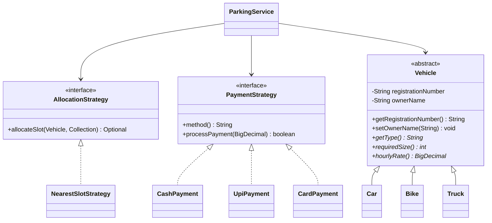

# Object-Oriented Design and Viva Notes

This guide uses class and method names from `src/main/java/com/smartparking`.

## Class relationships



## 1. Inheritance

**Definition:** A subclass inherits common state and behavior from a parent class and can provide specialized behavior.

**Implementation:** `Car`, `Bike`, and `Truck` extend the abstract `Vehicle`. `Vehicle` owns the registration number and owner name. Each subtype supplies its own type, required slot size, and hourly rate.

```java
public final class Car extends Vehicle {
    public String getType() { return "CAR"; }
    public int requiredSize() { return 2; }
    public BigDecimal hourlyRate() { return new BigDecimal("40.00"); }
}
```

**Why it helps:** Shared vehicle validation and identity live in one place; subtype-specific rules do not require duplicate vehicle classes or type-specific fields in the service.

## 2. Encapsulation

**Definition:** A class controls access to its data and exposes methods that preserve valid state.

**Implementation:** `Vehicle.registrationNumber` and `Vehicle.ownerName` are private. The registration is final after construction; the owner name can be changed only with `setOwnerName`, which validates nonblank input. `ParkingSlot.available` is private and changes through synchronized `occupy()` and `release()` methods that reject invalid transitions.

```java
private boolean available = true;
public synchronized void occupy() {
    if (!available) throw new IllegalStateException("Slot already occupied");
    available = false;
}
```

**Why it helps:** Callers cannot silently mark an occupied slot available by directly changing a public field; state changes pass through checks.

## 3. Abstraction

**Definition:** An abstract class or interface presents the operations callers need while hiding implementation details.

**Implementation:** Abstract `Vehicle` declares `getType()`, `requiredSize()`, and `hourlyRate()`. `AllocationStrategy` describes slot selection; `PaymentStrategy` describes a method and payment acceptance operation. `ParkingService` coordinates those behaviors without implementing slot-ordering details inside each GUI handler.

```java
public interface AllocationStrategy {
    Optional<ParkingSlot> allocateSlot(
        Vehicle vehicle, Collection<ParkingSlot> slots);
}
```

**Why it helps:** Service logic can depend on a stable behavior contract, while the implementation details remain in strategy classes.

## 4. Polymorphism

**Definition:** A common parent or interface reference can invoke the implementation appropriate to the actual object type.

**Implementation:** `ParkingService` handles a `Vehicle` reference. Calling `vehicle.requiredSize()` or `vehicle.hourlyRate()` dispatches to `Car`, `Bike`, or `Truck` at runtime. Payment processing similarly calls `PaymentStrategy.processPayment()` on a selected concrete strategy.

```java
BigDecimal amount = ticket.vehicle().hourlyRate()
    .multiply(BigDecimal.valueOf(hours));
if (!payment.processPayment(amount)) {
    throw new IllegalStateException("Payment was declined");
}
```

**Why it helps:** Fee calculation and slot fit use each subtype's overridden rules without duplicating the calculation in three branches.

## Interfaces and Strategy pattern

The project defines two strategy interfaces:

- `AllocationStrategy` is implemented by `NearestSlotStrategy`. The service asks the strategy to choose a slot; the strategy owns the priority ordering.
- `PaymentStrategy` is implemented by `CashPayment`, `UpiPayment`, and `CardPayment`. `ParkingService.exit` selects the concrete strategy for the chosen method and then uses the shared acceptance operation.

This is the Strategy pattern: behavior is encapsulated in interchangeable objects behind an interface. Payment implementations currently simulate acceptance for nonnegative amounts; they are not connections to a bank or payment gateway.

## Viva explanation

One concise explanation is: “The vehicle model uses inheritance for shared vehicle identity and subtype-specific parking rules. Private fields and checked state methods provide encapsulation. Abstract classes and interfaces provide abstraction. Overridden methods and the strategy interfaces give runtime polymorphism. The allocation and payment algorithms are isolated so the service coordinates the workflow without owning every implementation detail.”
