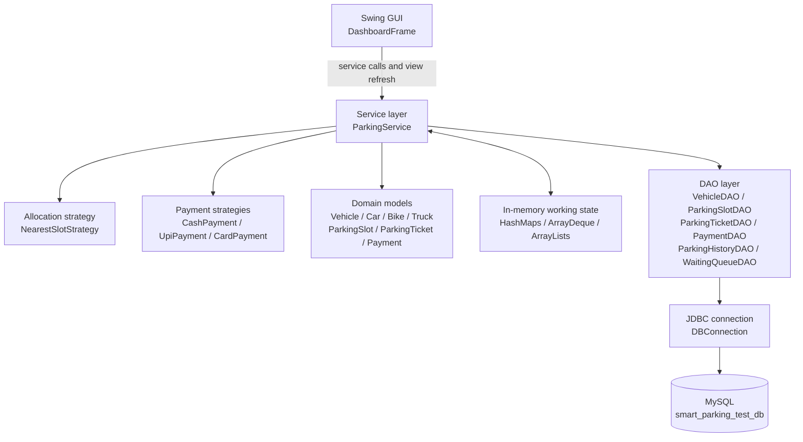
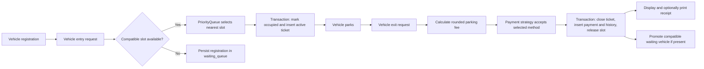
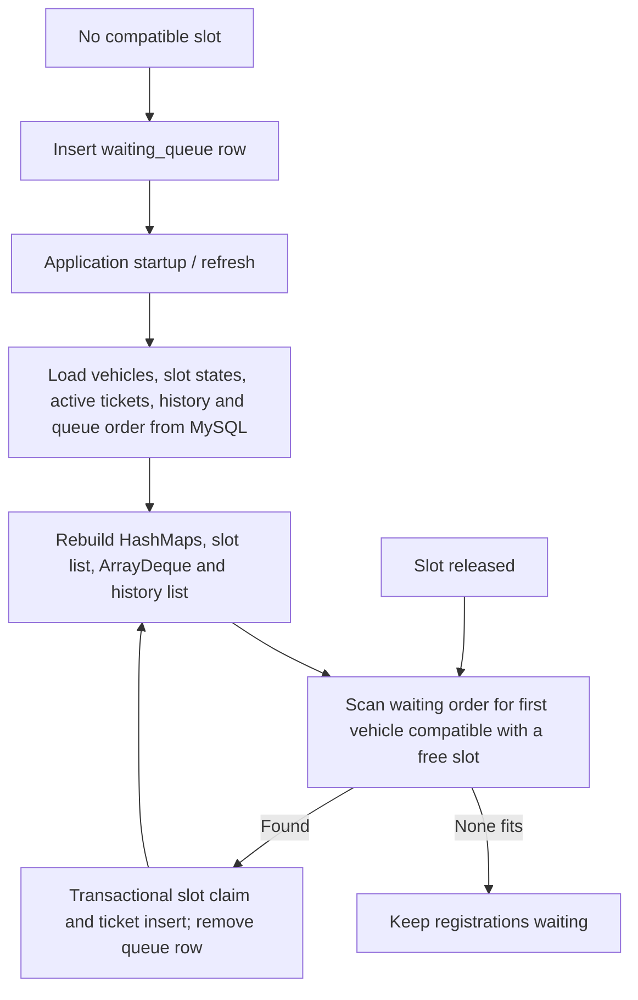

# Application Architecture

## Layered component view

The GUI calls `ParkingService`; it contains no SQL. The service owns workflow rules and DSA working collections, DAOs contain parameterized SQL and row mapping, and `DBConnection` obtains a JDBC connection from local properties or environment variables. The payment strategies simulate acceptance and do not contact a payment processor.

## Parking workflow

Entry and exit changes that affect multiple rows use JDBC transactions. The in-memory state is updated after the database transaction succeeds.

## Waiting queue and recovery

The queue is stored by `queue_id` and loaded in that order. Promotion considers the first queued vehicle that can use the newly available inventory; incompatible vehicles remain queued.

## Package responsibilities

| Package/class | Responsibility |
|---|---|
| `gui.DashboardFrame` | Swing tabs, user input, receipt view, and service-backed refresh |
| `service.ParkingService` | Registration and parking rules, fee calculation, transactions, recovery, DSA synchronization |
| `interfaces` and `strategy` | Pluggable allocation/payment behavior |
| `model` | Vehicle, slot, ticket, and payment domain values |
| `dao` | Prepared SQL, persistence, and database row mapping |
| `database.DBConnection` | Connection settings and JDBC connection creation |
| `Main` | Starts the Swing UI and reports startup connection errors |
